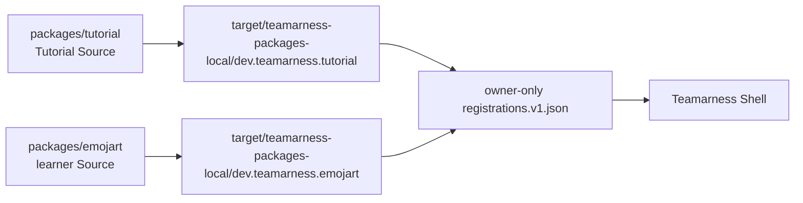
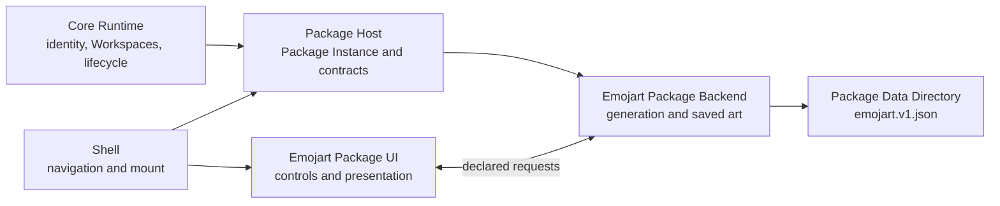

# Build your first Package with an agent

Start by running Tutorial, the finished local Package shipped in this clone. Tutorial is an emoji-art Package with the result you will build yourself later. It remains installed while you create a separate Emojart Package at `packages/emojart/`.

This guide is for Apple silicon macOS with Rust 1.96 or newer and Node.js 24 or newer. Run `npm ci` and `cargo fetch --locked` first. The SDK is private to this monorepo. This is not a recipe for publishing an external Package SDK.

## Preview the finished Tutorial Package

Use a fresh named development profile. The setup command builds Tutorial, stages `target/teamarness-packages-local/dev.teamarness.tutorial/`, creates the private profile directories, and writes its owner-only registration. It does not bundle Tutorial or change application metadata.

```sh
npm run setup:tutorial -- tutorial-preview
npm run dev -- tutorial-preview
```

Create or select a Workspace and open Tutorial. Confirm the Shell reports source `local`, trust `trusted_native_code_v1`, an active lifecycle, and the emoji-art UI. Stop Teamarness cleanly before changing registrations.

Tutorial is an installation-local Package Source. It is not a bundled application Package, Workspace enablement, synchronization, networking, or collaboration feature. The native Package Backend has the current user's filesystem, network, and process authority. It is not a sandbox. The same-webview Package UI can reach Shell DOM and known Tauri commands. Review both before registering code.

The setup command writes `.teamarness-dev/tutorial-preview/packages/registrations.v1.json` with a canonical absolute directory and the complete `trusted_native_code_v1` acknowledgement. Its profile and `packages` directories have mode `700`; its registration file has mode `600`. Restart after changing the file.

## Keep the two Packages straight

Tutorial is checked in at `packages/tutorial/`, has identity `dev.teamarness.tutorial`, uses `tutorial.read`, `tutorial.generate`, and `tutorial.save`, and keeps its local records in `tutorial.v1.json`. Emojart is your separate Package. Create it from an empty `packages/emojart/` directory with identity `dev.teamarness.emojart`, its own `emojart.*` request namespace, and `emojart.v1.json` state file. Do not delete, rename, or modify Tutorial while working through this guide.



A Package Source is the concrete Package Directory that an Installation discovers. A Package Identity stays stable across sources and versions. The Package Host creates a Package Instance for each Workspace. Each instance gets a Package Data Directory keyed by Installation, Workspace, and Package Identity. Tutorial and Emojart therefore have separate local state, and each Package's saves are Workspace-specific.

## Step 1: create Emojart from empty source

### Agent brief 1

```text
Create a new Emojart Package under an empty packages/emojart/ directory. Do not copy, rename, delete, or modify packages/tutorial/.

Use docs/package-author-guide.md, docs/local-package-registration.md, contracts/packages/v1/, crates/teamarness-package-sdk/README.md, packages/teamarness-package-ui-sdk/, and packages/reference-package/ for supported shapes.

Give Emojart identity dev.teamarness.emojart. Add a Rust Backend and TypeScript UI workspace to the root Cargo.toml and package.json. Add teamarness.package.json and ui-contract.json. Declare only emojart.read, emojart.generate, and emojart.save, with no subscriptions, capabilities, assets, network behavior, or synchronization.

Do not add either Tutorial or Emojart to packages/application-packages.v1.json or apps/teamarness-desktop/src-tauri/tauri.conf.json. Add focused contract tests and run them.
```

### Human checkpoint 1

Review `packages/emojart/`, not `packages/tutorial/`. Confirm the manifest identity is `dev.teamarness.emojart`, the contract has the three `emojart.*` requests and empty `subscriptions`, and neither application metadata nor Tauri resources changed.

## Step 2: implement Emojart's Backend

The Core Runtime owns Installation identity, Workspaces, canonical membership, and Package lifecycle. The Shell owns navigation and Package UI mounting. The Package Host routes declared contracts. Emojart owns art rules, saved records, its Package Backend, and its Package UI.



### Agent brief 2

```text
Implement packages/emojart/backend/ against its declared UI contract. Do not read or reuse Tutorial source.

Support waves, ripples, and sierpinski; garden, ocean, space, and fruit; generatorVersion 1; and a 16 by 12 grid. emojart.generate creates a fresh Backend-owned unsigned 32-bit seed. Equal recipes render equal cells. emojart.save accepts a recipe, regenerates cells in the Backend, assigns stable IDs, and writes a closed schemaVersion 1 emojart.v1.json document in the granted Package Data Directory with temporary-file replacement.

Do not add browser persistence, capabilities, subscriptions, network calls, or synchronization. Add real temporary-directory tests, then run cargo test -p teamarness-emojart-package --locked, cargo fmt --all --check, and cargo clippy -p teamarness-emojart-package --all-targets --all-features --locked -- -D warnings.
```

### Human checkpoint 2

Read the tests. They should show reproducible recipes, different selected seeds, rejected choices, and save-and-reopen continuity. The state path must come from the host rather than a hard-coded path or browser storage.

## Step 3: implement the Emojart UI

### Agent brief 3

```text
Implement packages/emojart/ui/ using only the mount-scoped PackageClient and the Emojart UI contract. Do not copy Tutorial files or use direct Tauri commands.

Export mount(context) and an idempotent unmount function. Use only emojart.read, emojart.generate, and emojart.save. Show algorithm and palette selects, Generate, Save, a fixed CSS grid, saved-art selection, concise labels, and visible request errors. Generate keeps selected controls and asks the Backend for a fresh seed. Decorative cells stay out of the accessibility tree.

Add focused client-flow tests. Run the Emojart UI build, typecheck, lint, and tests.
```

### Human checkpoint 3

Confirm the UI test names show initial read, selector-preserving Generate, Save, and saved-art selection without a replacement generation. The UI does not own persistence.

## Step 4: assemble Emojart bytes

Source files are not a Package Directory. Your agent should add an Emojart assembly command after the Backend and UI work. It must stage final bytes, then calculate sizes and lowercase SHA-256 digests in the staged manifest.

### Agent brief 4

```text
Add npm run build:emojart for the learner-created Package. It must build the release Backend and ESM UI and stage target/teamarness-packages-local/dev.teamarness.emojart/ with the Backend executable, ui/index.js, ui/contract.json, final sizes, lowercase SHA-256 digests, and owner-only final permissions.

Reuse scripts/package-directory.mjs if useful. Add a focused staging test. Do not alter npm run build:tutorial, target/teamarness-packages-local/dev.teamarness.tutorial/, packages/application-packages.v1.json, or apps/teamarness-desktop/src-tauri/tauri.conf.json.
```

### Human checkpoint 4

Run `npm run build:emojart`. Inspect `target/teamarness-packages-local/dev.teamarness.emojart/`. The staged manifest should have nonzero byte sizes and lowercase SHA-256 digests. The checked-in Emojart source manifest may use placeholders before assembly.

## Step 5: add Emojart without removing Tutorial

Tutorial's registration stays in the named profile. Add a second registration entry for Emojart. Do not delete the Tutorial entry, and do not use `overrideApplication` because neither identity is bundled.

### Agent brief 5

```text
Review the proposed registration change for the learner-created Emojart Package without changing application code. Preserve the existing dev.teamarness.tutorial registration in the named tutorial-preview profile. Add one registration for target/teamarness-packages-local/dev.teamarness.emojart with expectedIdentity dev.teamarness.emojart and the complete trusted_native_code_v1 acceptedRisks acknowledgement.

Use canonical absolute paths. Keep the profile and packages directories mode 700 and registrations.v1.json mode 600. Confirm packages/application-packages.v1.json and apps/teamarness-desktop/src-tauri/tauri.conf.json omit both identities. Restart Teamarness after the file changes.
```

### Human checkpoint 5

After `npm run build:emojart`, edit the existing registration file from the repository root. Preserve the Tutorial object and append Emojart:

```sh
repository="$(pwd -P)"
profile="$repository/.teamarness-dev/tutorial-preview"
package_directory="$repository/target/teamarness-packages-local/dev.teamarness.emojart"
# Keep the existing Tutorial registration, then add this second object to registrations:
# {
#   "directory": "$package_directory",
#   "expectedIdentity": "dev.teamarness.emojart",
#   "trust": {
#     "kind": "trusted_native_code_v1",
#     "acceptedRisks": ["filesystem", "network", "process"]
#   }
# }
chmod 700 "$profile" "$profile/packages"
chmod 600 "$profile/packages/registrations.v1.json"
npm run dev -- tutorial-preview
```

Confirm both Tutorial and Emojart report source `local`, trust `trusted_native_code_v1`, and active lifecycles. Run every pattern with several palettes, press Generate repeatedly, save two pieces, restart, and confirm the saves return. A second Workspace starts with an empty saved-art list. There is no hot reload. Rebuild first and restart second. A changed Backend while Teamarness is running can fail with `artifact_changed`.

## Troubleshooting

- **Digest mismatch:** Rebuild, then register the staged Package Directory. Do not edit admitted bytes.
- **Unsupported target:** This guide builds `aarch64-apple-darwin`. Supporting another target needs a declared executable and separate work.
- **Invalid UI contract:** Keep the `emojart.*` request names aligned with `packages/emojart/ui-contract.json`.
- **Registration permissions:** Keep profile and `packages` at mode `700` and `registrations.v1.json` at mode `600`. It must be regular, not a symlink.

Emojart stays installation-local. It does not add bundling, Workspace enablement, synchronization, networking, or collaboration. A future tutorial can cover promotion to application distribution and synchronized team behavior, but a local registration file does neither.
