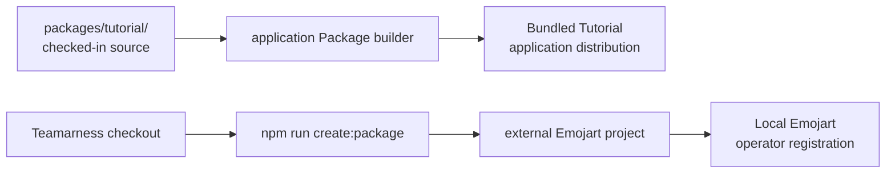
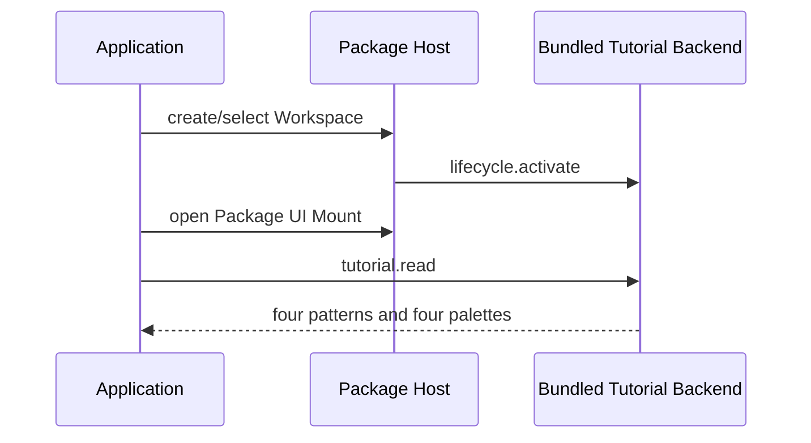

# Build your first Package with an agent

This guide follows three different Package paths. Do not confuse them:

1. **Checked-in source**: Tutorial source lives at `packages/tutorial/` in the Teamarness repository.
2. **Bundled Package**: the application distribution contains `dev.teamarness.tutorial` under `packages/dev.teamarness.tutorial/`. It appears as `Bundled` without an installation registration file.
3. **Learner-owned local Package**: you generate `dev.teamarness.emojart` into a separate directory outside this repository, then register that completed Package Directory as `Local`.

The Package Source kind is descriptive. `Bundled` and `Local` are not security verdicts and do not grant Workspace enablement, synchronization, sharing, networking, or collaboration.



## Before you start

Use a fresh Teamarness checkout and a fresh private data directory. The supported Package target is `aarch64-apple-darwin`. Package Processes have the current user's ambient filesystem, network, and process authority; a Package is not a sandbox. Package UI runs in the same-webview Package UI host, so UI code must treat the DOM and Tauri command boundary as host-owned.

Build the application Packages when working from source:

```sh
npm install
npm run build:application-packages
```

Create or select a Workspace. Tutorial should be visible before you create any registration file, and the Shell should show `Bundled`, its lifecycle, and its process generation. Tutorial uses identity `dev.teamarness.tutorial`, the `tutorial.read`, `tutorial.generate`, and `tutorial.save` requests, and stores Package Data in `tutorial.v1.json`.



Do not modify Tutorial while working on Emojart. The exercise is to create a separate project, not to fork or rename `packages/tutorial/`.

## Generate the external foundation

From the Teamarness checkout, choose an absent or empty destination outside the repository:

```sh
npm run create:package -- \
  --output /absolute/path/to/emojart \
  --identity dev.teamarness.emojart \
  --display-name Emojart
cd /absolute/path/to/emojart
npm ci
```

The generator creates a foundation only. It vendors the canonical Rust protocol, Rust Backend SDK, and TypeScript UI SDK under `vendor/teamarness/`, supplies standalone manifests, and records template version `1`, Package Process Protocol `1.0`, and UI host version `1` in `teamarness-authoring.json`. The generated project owns its `Cargo.lock` and `package-lock.json` lockfiles and has no Teamarness checkout dependency after generation. SDK fixes do not reach it automatically; there is no supported in-place SDK upgrade yet.

The generated project is intentionally not added to Teamarness Cargo or npm workspaces. Its manifest is request-only, has no capabilities or assets, and the initial request is `emojart.read`. Application-index editing is owned by the application Package builder; do not edit `packages/application-packages.v1.json` for a local Package.

## Agent brief 1: inspect the foundation

> Inspect the generated external Package project. Confirm its manifest, UI contract, provenance, vendored SDK source, standalone Cargo and npm manifests, and locked dependency files. Do not edit Teamarness source or application metadata. Report the exact files you will change.

### Human checkpoint 1

Confirm that the generated directory is outside the Teamarness repository, contains `vendor/teamarness/`, has `teamarness-authoring.json`, and contains no absolute checkout path or Teamarness registry dependency.

## Agent brief 2: implement the Backend

> Implement Emojart Backend behavior in the generated project only. Keep algorithm selection, palette selection, seed creation, validation, formula execution, and save-time regeneration in the Backend. Use the closed UI contract and Package Process Protocol. Do not add capabilities, subscriptions, networking, Workspace behavior, or direct Tauri commands.

Implement four deterministic patterns: Waves, Ripples, Spiral, and Patchwork. Use a fixed 16 by 12 row-major grid, generator version 1, and these exact eight-entry palettes:

- Garden: `🌱 🌿 🍀 🌸 🌻 🪻 🌷 🐝`
- Ocean: `💧 🐚 🐠 🐬 🌊 🪼 🐙 🐳`
- Space: `🌑 🌒 🌓 🌔 🌕 ⭐ 🪐 🚀`
- Fruit: `🍓 🍊 🍋 🍏 🫐 🍇 🍉 🍒`

### Human checkpoint 2

Run the generated project's locked Backend tests. Confirm equal recipes render equal cells, selected seeds change every pattern, every result has 192 cells, and every cell belongs to the selected palette.

## Agent brief 3: implement the UI

> Implement the generated Package UI against the mount-scoped PackageClient and UI contract. Send only algorithm and palette IDs in generation requests. Render the Backend response, keep Pattern and Palette labels readable, expose the artwork as `role="img"`, and keep decorative cells `aria-hidden="true"`. Do not calculate art in the UI or call Tauri directly.

### Human checkpoint 3

Run the generated UI typecheck, lint, and tests. Confirm all four patterns and all four palettes are selectable and the UI sends no seed or cell data in its generation request.

## Agent brief 4: build and inspect the Package Directory

> Run the generated project's `npm run typecheck`, `npm run lint`, `npm test`, and `npm run build`. Inspect `dist/dev.teamarness.emojart/`. Confirm the Backend is mode `0700`, UI, contract, and manifest bytes are mode `0600`, and every declared size and lowercase SHA-256 digest matches the final bytes.

### Human checkpoint 4

Confirm that `dist/dev.teamarness.emojart/teamarness.package.json` has nonzero Backend and UI sizes, lowercase digests, exact identity, and no capabilities or assets. Keep the generated lockfiles committed with the project.

## Agent brief 5: register and exercise the local Package

> Prepare the operator-owned local registration for the generated Package Directory using the registration format documented in Local Package registration. Preserve the bundled Tutorial and use the exact identity `dev.teamarness.emojart`. Do not add the local Package to Teamarness application metadata. Restart Teamarness after registration.

### Human checkpoint 5

From a fresh Teamarness profile, confirm Tutorial is `Bundled` before registration. Register Emojart with trust kind `trusted_native_code_v1`, restart, confirm Emojart is `Local`, and open both Package UI Mounts. Complete `tutorial.read` and `emojart.read`. Exercise all four patterns and palettes, save two pieces, restart, confirm continuity, and select a second Workspace to confirm its saved-art list starts empty.

Registration remains owner-only through `registrations.v1.json`. Package trust, source kind, Workspace enablement, synchronization, sharing, networking, and collaboration remain separate concepts. There is no hot reload.

## Troubleshooting

- **Digest mismatch or `artifact_changed`:** rebuild the external Package Directory and check declared final bytes.
- **Unsupported target:** use the supported `aarch64-apple-darwin` target.
- **Invalid UI contract:** keep request names aligned with the generated `ui-contract.json` and preserve an empty `subscriptions` object.
- **Backend does not appear:** verify the owner-only registration path, exact `expectedIdentity`, trust record, and restart requirement.
- **No Workspace data:** Package Data Directory state is Workspace-specific; source kind does not synchronize or share it.
