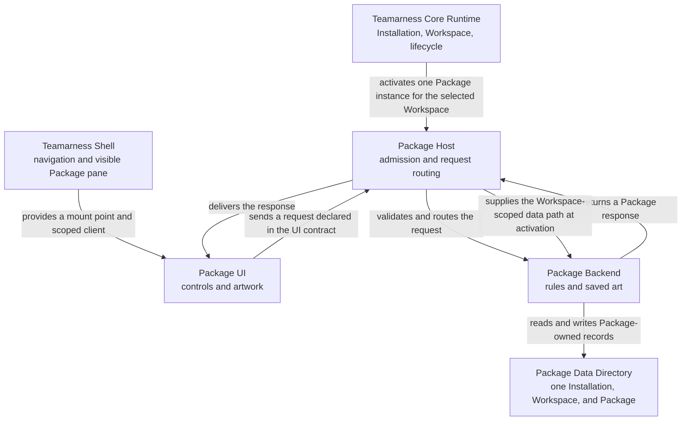
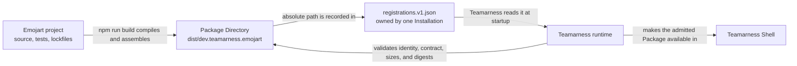

# Build your first Package with an agent

You have seen what Teamarness can do. Now you are going to add a small product feature of your own.

In Teamarness, that feature is a Package. The Core Runtime takes care of the application concerns that every Package shares, such as Installation identity, Workspaces, and lifecycle. Your Package owns one product area from its data and behavior through to its UI.

You will build Emojart, an emoji pattern generator that runs inside Teamarness. A coding agent will write most of the code. Your job is to give it one bounded task at a time, review the decisions at each boundary, and run the result before moving on. You do not need prior knowledge of the Teamarness Package architecture. You should be comfortable reading code, tests, and JSON contracts.

By the end, you will have:

- a Package project in its own directory and repository;
- a Rust Backend that generates and saves emoji art;
- a TypeScript UI mounted by the Teamarness Shell;
- a built Package Directory that Teamarness can admit; and
- saved art that belongs to one Workspace and survives an application restart.

This guide uses Apple silicon macOS, Rust 1.96 or newer, and Node.js 24 or newer. The current Package target is `aarch64-apple-darwin`.

## Start with the finished experience

Before you read manifests or write code, use the finished Tutorial Package. This gives the architecture something concrete to attach to.

From a fresh Teamarness checkout, install the locked dependencies and start a new development profile:

```sh
npm ci
cargo fetch --locked
npm run dev -- first-package
```

The first launch builds the application and its bundled Packages, so it may take a few minutes. Keep the terminal open while Teamarness runs.

In Teamarness:

1. Create or select a Workspace.
2. Open Tutorial.
3. Try each pattern and a few palettes.
4. Generate several pieces without changing the controls.
5. Save several pieces and click between them.

You have now used all the parts of a Package that matter for this guide:

- The Teamarness Shell renders the desktop, navigation, and a place for Package UI.
- The Tutorial UI owns the controls and artwork you can see.
- The Package Host starts the Backend and carries declared requests between the UI and Backend.
- The Tutorial Backend owns the pattern rules and saved-art behavior.
- The Package Data Directory holds Tutorial's records for this Installation and Workspace.
- The Teamarness Core Runtime owns the Installation, selected Workspace, and Package lifecycle.

The arrows below name what crosses each relationship.



The main design boundary is between the Teamarness Core Runtime and each Package, including Emojart. The Teamarness-owned Shell and Package Host connect the two sides.

- The Teamarness Core Runtime owns the application and Workspace concerns that every Package shares.
- Emojart, like any other Package, owns its product contract, rules, records, Backend, and UI.

This is why Emojart will be a separate project. You are adding a Package to Teamarness, not adding emoji-art code to the Core Runtime or Shell.

Quit Teamarness before continuing. You will return to the same `first-package` profile after Emojart is built. Do not edit `packages/tutorial/`. Tutorial is the finished example, while Emojart is the Package you own.

Keep these three paths separate:

- Checked-in Tutorial source lives at `packages/tutorial/` in the Teamarness repository.
- The application builder assembles bundled Tutorial as `dev.teamarness.tutorial` at `packages/dev.teamarness.tutorial/` in the application distribution. The Shell presents its Package Source as `Team`.
- Learner-owned local Emojart lives in its own project outside the Teamarness repository. The Shell presents the registered Package Source as `Personal`.

<a id="source-and-trust"></a>

> **Source and trust.** Package Source values `bundled` and `local` remain the technical source kinds. `Team` and `Personal` are UI aliases, not trust verdicts, and do not define registration scope, Workspace enablement, synchronization, sharing, networking, or collaboration. A Package Backend runs as native code with the current user's filesystem, network, and process authority: it is not a sandbox. Only the Package UI is sandboxed — it runs in a sandboxed frame with an opaque origin, reaching neither the Shell's DOM nor any Tauri command, and a sandboxed frame does not contain a UI that blocks its thread. Review the code you register.

## How a local Package reaches Teamarness

Tutorial arrived with the Teamarness application. Emojart will be a local Package, so it follows a different deployment path.

Teamarness does not build a local Package as part of its own build. Each local Package lives in a separate project directory, can have its own Git repository, and produces its own Package Directory. An Installation-level registration file points Teamarness to that built directory. Teamarness reads the registration at startup, validates the Package manifest and its declared files, then makes the Package available in the Shell.



Two files have different jobs here. `teamarness.package.json` lives inside the Package Directory and describes the identity and exact files Teamarness will run. `registrations.v1.json` belongs to one Teamarness Installation and points to the Package Directory by its absolute path. That registration entry is the only connection between the Emojart project and your Teamarness development profile.

A local registration makes the Package available to this Installation. It does not add the Package to the Teamarness application build. It also does not grant Workspace enablement, synchronization, sharing, networking, or collaboration.

## Generate your Package project

Keep local Package projects together without putting them inside the Teamarness checkout. This guide uses `$HOME/Projects/teamarness/local-packages/`. Give each Package its own child directory and, when you are ready, its own Git repository.

From the Teamarness checkout, create the parent directory and generate Emojart:

```sh
LOCAL_PACKAGES="$HOME/Projects/teamarness/local-packages"
mkdir -p "$LOCAL_PACKAGES"

npm run create:package -- \
  --output "$LOCAL_PACKAGES/emojart" \
  --identity dev.teamarness.emojart \
  --display-name Emojart

cd "$LOCAL_PACKAGES/emojart"
npm ci
```

The generator requires an absent or empty output directory. It does not add Emojart to the Teamarness Cargo or npm workspaces, and later Teamarness builds will not rebuild it for you.

The generated project already has a small end-to-end request named `emojart.read`. The UI calls it and displays a greeting returned by the Backend. That small path is useful. You are extending a working Package rather than assembling every protocol detail from nothing.

The files you will work with are:

```text
AGENTS.md                    Architecture and working rules for coding agents
README.md                    How to build, check and register this project
LICENSE                      The project's own license
teamarness.package.json     Package identity and built artifacts
ui-contract.json            Requests shared by the UI and Backend
backend/src/                Rust behavior and local data; main.rs only starts the router
backend/tests/              The Backend driven through the SDK test harness
ui/src/                     TypeScript UI
ui/src/contract.generated.ts
                            Request types generated from ui-contract.json
scripts/assemble-package.mjs
                            Builds the final Package Directory
scripts/assemble-package.test.mjs
                            Proves the assembled directory's shape and modes
scripts/validate-dist.mjs   Validates and smoke-launches the built directory
scripts/verify-vendor.mjs   Reports an edited vendored SDK file
vendor/teamarness/          Generated copies of the current SDK sources
teamarness-authoring.json   Generator, protocol and vendoring provenance
```

`backend/src/main.rs` stays thin — it starts the router and nothing else — so the product rules live in `backend/src/lib.rs` where the tests can reach them.

The project also owns `Cargo.lock` and `package-lock.json`. Commit both lockfiles in the Emojart repository.

The generator currently copies the Rust protocol, Rust Backend SDK, and TypeScript UI SDK into `vendor/teamarness/`. This keeps the generated project independent of your Teamarness checkout. It also means SDK fixes do not arrive automatically. There is no supported in-place SDK upgrade yet.

## Step 1: ask the agent to map the foundation

Start by making the agent explain the project it is about to change. This catches wrong working directories and gives you a shared vocabulary before implementation begins.

### Agent brief 1

> Work only in this generated Emojart project. Read `AGENTS.md` first and use it as the repository's architecture and working agreement. This is an inspection step. Do not implement Emojart yet, and do not ask for its feature requirements. The next brief will provide them.
>
> Explain how `teamarness.package.json`, `ui-contract.json`, the Rust Backend, the TypeScript UI, `scripts/assemble-package.mjs`, and `vendor/teamarness/` fit together. Confirm that `emojart.read` works from UI request to Backend response. Report the files you expect the feature work to change.
>
> The manifest and assembly script are inside the generated project boundary, but the planned feature should not change its artifact shape: one Backend, one bundled UI entrypoint, one contract, no assets, and the existing target. Do not edit the Teamarness checkout or application Package metadata.

### Human checkpoint 1

Check the agent's map against the file list above. In particular, confirm:

- the Package identity is `dev.teamarness.emojart`;
- the only initial product request is `emojart.read`;
- `AGENTS.md` describes the Teamarness boundary, Package ownership, and required checks;
- the project contains `teamarness-authoring.json`, `Cargo.lock`, and `package-lock.json`;
- dependencies under `vendor/teamarness/` use relative project paths; and
- no file contains an absolute path back to the Teamarness checkout.

Do not worry about the process protocol frame format. The vendored Backend SDK owns that machinery. Your working boundary is the Package request contract.

## Step 2: put the product rules in the Backend

Emojart needs three requests:

- `emojart.read` returns the available patterns, palettes, and saved art;
- `emojart.generate` accepts a pattern and palette, then returns a complete seeded recipe and its rendered cells;
- `emojart.save` accepts that complete recipe, renders it again, and stores the same piece the user saw.

The contract describes those messages. It lets the host reject undeclared operations and invalid payloads before product code has to guess what it received.

The Backend owns seeds and rendering because those are Emojart rules. The UI sends choices, not generated cells. The canonical recipe includes generator version, algorithm, palette, seed, width, and height. That full recipe is what makes a piece reproducible.

The Backend also owns saved records because its lifetime and data do not depend on whether the UI is visible. Teamarness chooses the correct Package Data Directory for the current Installation, Workspace, and Package identity. Emojart chooses the file format inside it.

### Agent brief 2

> Replace the greeting foundation with the Emojart contract and Backend behavior. Work only in this generated project.
>
> Declare `emojart.read`, `emojart.generate`, and `emojart.save` in the closed `ui-contract.json`. Keep `subscriptions` empty and add no capabilities or assets.
>
> Use these product shapes in the contract:
>
> - A canonical recipe contains `generatorVersion`, `algorithm`, `palette`, `seed`, `width`, and `height`.
> - A draft contains `{ recipe, cells }`.
> - A saved artwork contains `{ id, recipe, cells }`.
> - `emojart.generate` accepts only `{ algorithm, palette }` and returns a draft.
> - `emojart.save` accepts `{ recipe }` and returns a saved artwork.
> - `emojart.read` returns the pattern choices, palette choices, and saved artworks.
>
> Implement four deterministic patterns named Waves, Ripples, Spiral, and Patchwork. Render a 16 by 12 row-major grid with generator version 1. The Backend creates a fresh unsigned 32-bit seed for each generation request, puts it in the canonical recipe, and passes that complete recipe to the renderer. Every pattern must use the seed when choosing cells. Equal complete recipes must produce equal cells. Changing only the seed must change the cells for every pattern.
>
> Use these exact five-emoji palettes:
>
> - Garden: `🌱 🌿 🍀 🌸 🌻`
> - Ocean: `💧 🐚 🐠 🐬 🌊`
> - Moon: `🌑 🌒 🌓 🌔 🌕`
> - Fruit: `🍓 🍊 🍋 🍏 🫐`
>
> Build each pattern around one recognizable geometric idea:
>
> - Waves combines horizontal and vertical sine waves. Derive phase and a small horizontal and vertical frequency from the seed.
> - Ripples maps radial distance from the grid center through a sine wave. Let the seed change its phase and frequency.
> - Spiral combines polar angle with normalized distance from the center. Let the seed rotate the phase so the arms move without losing their spiral shape.
> - Patchwork places five seed-stable control points across the grid, one for each palette entry. Give each cell the palette entry belonging to its nearest control point, producing seeded Voronoi-like regions.
>
> Map each continuous wave value evenly into the five palette positions. For every pattern, let the seed change coherent parameters such as phase, frequency, rotation, or control-point positions. Do not add independent random noise to each cell. Per-cell noise hides the pattern instead of producing a new version of it.
>
> Keep `main.rs` thin. Register the three requests as typed handlers on the foundation's `Router`, and build the activation state from the data directory supplied at initialization (`Activation::data_directory()`).
>
> Store a closed schema-version-1 document named `emojart.v1.json` in that directory through the SDK's `storage::JsonDocumentStore`, which writes through a temporary file and fsyncs before adopting the new value. Give saved pieces stable IDs. On save, use the submitted canonical recipe and render its cells again. Do not create a new seed during save. Name a failed read or write `emojart.storage_failed` and mark it retryable only if repeating the same request may succeed. Do the file work inside `ctx.blocking(...)` so it stays off the async runtime. Do not add browser storage, networking, synchronization, direct Tauri commands, or Workspace logic.
>
> Add focused Rust tests for valid and invalid choices, deterministic recipes, seed variation, 192-cell output, palette membership, exact save regeneration, and reopening from a real temporary directory. Drive the whole Backend through `teamarness_package_sdk::testing` — activate, request, dispose — against a real temporary Package Data Directory rather than hand-built frames, and keep `assert_router_matches_contract` passing so the router and `ui-contract.json` cannot drift. Test rendering with fixed seeds through a pure or injected seam. For every pattern, prove that seed 7 is reproducible and that seed 91 produces different cells. A changed seed field with identical cells does not pass. Also prove that saving a generated recipe stores the same cells that were shown in its draft. Run `npm run validate`, then the locked Backend tests, formatter, and Clippy with warnings denied. Report what the tests prove.

### Human checkpoint 2

Review the contract before the implementation details. It should describe the complete product conversation and nothing else.

Then inspect the Backend tests. Confirm that they show:

- the same complete recipe always renders the same cells;
- changing only the fixed seed changes the cells for every pattern;
- each result has exactly 192 cells from the chosen palette;
- unknown pattern and palette IDs fail;
- saving a draft's recipe reproduces that draft rather than creating a new seed;
- saves use `emojart.v1.json` under the host-supplied directory; and
- reopening that directory restores the saved records.

If the UI computes patterns or the Backend writes to a hard-coded path, stop here. That would put product ownership on the wrong side of the boundary.

## Step 3: build the Package UI

The Shell gives Emojart a place to mount and a client scoped to this Package instance. Emojart should use that client for its three declared requests. It should not call Tauri itself.

The UI owns interaction and presentation. It keeps the selected controls, asks the Backend for a generated draft, displays the response, and lets the user select previously saved art. It does not become the source of truth for recipes or persistence.

### Agent brief 3

> Implement the Emojart UI against `ui-contract.json` and the mount-scoped `PackageClient`. Work only in this generated project.
>
> Regenerate `ui/src/contract.generated.ts` from `ui-contract.json` with `teamarness-contract-types`, commit it, and call the Backend through `typedPackageClient<PackageContract>(context.client)` so an operation name or payload the contract does not describe fails `npm run typecheck`.
>
> Export `mount(context)` and return an idempotent unmount function. On mount, call `emojart.read`, select the first palette and pattern, and request an initial draft. Put the palette dropdown first and the pattern dropdown second so the controls read naturally as combinations such as "Ocean Spiral" or "Garden Patchwork". Keep the dropdowns, but show no visible labels above or beside them. Give them the accessible names `Palette` and `Pattern` with `aria-label`.
>
> Add Generate and Save buttons, a fixed 16 by 12 artwork grid, a saved-art list, and visible request errors. Show the Package's own error code — `packageErrorCode(error)` returns `emojart.storage_failed` when the Backend refused, and `null` when Teamarness owned the failure — and use `describePackageError(error)` for the sentence. Ignore an abort with `isAbortError(error)`; never render raw `details`. Name artwork and saved-art choices in palette-then-pattern order.
>
> Generate must preserve the selected controls and send only algorithm and palette IDs. Keep the complete draft returned by the Backend. Save must send that draft's canonical recipe, including its seed, so Save stores the artwork currently on screen. Selecting saved art must display it without generating a replacement. Expose the artwork as `role="img"`, give it a useful accessible label, and mark the 192 decorative cells `aria-hidden="true"`.
>
> Use only `context.client` for Package requests. A sandboxed frame has no Tauri commands, no browser storage, and no network, so do not attempt them; do not add remote imports or rendering formulas. Add focused UI tests for dropdown order and accessible names, absence of visible dropdown labels, the initial read, generation, saving the visible recipe, saved-art selection, errors, and idempotent unmount. Run the UI typecheck, lint, and tests.

### Human checkpoint 3

Read the UI tests as a description of the user flow. Confirm that:

- the initial screen comes from `emojart.read` and `emojart.generate`;
- changing a control does not invent a draft in the browser;
- the controls appear as palette then pattern with no visible labels and retain accessible names;
- Generate asks the Backend for a new result without resetting the controls;
- Save sends the complete visible recipe, including its seed, rather than cells;
- selecting saved art does not trigger another generation; and
- all Package communication goes through the provided client.

At this point the product split should be visible in the code. TypeScript presents the feature. Rust owns what the feature means and what it saves.

## Step 4: build the Package Directory

Source code is not what Teamarness runs. Teamarness admits a Package Directory containing a self-contained Backend executable, one ESM UI entrypoint, the UI contract, and a manifest that identifies those exact bytes.

The generated build script already knows how to assemble that directory. It calculates sizes and lowercase SHA-256 digests after the final files exist. If any admitted byte changes later, Teamarness rejects it until you rebuild and restart.

### Agent brief 4

> Run `npm run validate`, `npm run typecheck`, `npm run lint`, and `npm test` from the generated project. `npm run lint` already runs the formatter and Clippy with warnings denied, and `npm test` already runs the validator and the vendored-SDK check, so do not repeat them. Fix failures without weakening tests or changing the product boundary. Then run `npm run build`.
>
> Inspect `dist/dev.teamarness.emojart/`. Verify that it contains the manifest, Backend executable, ESM UI, and UI contract. Confirm that every manifest size and lowercase SHA-256 digest matches the final file, the Backend has mode `0700`, and the manifest, UI, and contract have mode `0600`. Confirm that the manifest identity remains `dev.teamarness.emojart` and declares no capabilities or assets. Report the exact directory Teamarness should register.

### Human checkpoint 4

Run the checks yourself from the Emojart project:

```sh
npm run validate
npm run typecheck
npm run lint
npm test
npm run build
```

`npm run validate` gives the Package Host's own verdict on this project without starting Teamarness; `npm run build` assembles `dist/dev.teamarness.emojart/` and then validates and smoke-launches it.

Inspect `dist/dev.teamarness.emojart/teamarness.package.json`. Its Backend and UI sizes should be nonzero, and its digests should be lowercase hexadecimal. Register the `dist/dev.teamarness.emojart/` directory, not the project root.

This distinction matters. Your project is where you author Emojart. The Package Directory is the built unit Teamarness validates and runs.

## Step 5: register and run your Package

A local registration tells one Teamarness Installation where to find your built Package Directory. It does not add Emojart to the application bundle or make it available to anyone else.

Review the code before registering it. The [Source and trust](#source-and-trust) callout above states what registering native Package code means.

### Agent brief 5

> Review the completed Emojart project as code that will run with the current user's authority. Confirm that its manifest, contract, Backend operations, UI requests, dependencies, and built bytes match this guide. Prepare the exact `registrations.v1.json` entry for `dist/dev.teamarness.emojart/` with expected identity `dev.teamarness.emojart` and trust kind `trusted_native_code_v1`. Do not edit Teamarness application metadata, add `overrideApplication`, or claim Workspace enablement, synchronization, sharing, networking, or collaboration. Wait for me to approve the registration.

### Human checkpoint 5

After you approve the code, register it in the same `first-package` development profile you used earlier. Replace both example paths below with canonical absolute paths:

```sh
TEAMARNESS_ROOT=/absolute/path/to/teamarness
EMOJART_PROJECT="$HOME/Projects/teamarness/local-packages/emojart"

mkdir -p "$TEAMARNESS_ROOT/.teamarness-dev/first-package/packages"
chmod 700 \
  "$TEAMARNESS_ROOT/.teamarness-dev/first-package" \
  "$TEAMARNESS_ROOT/.teamarness-dev/first-package/packages"

cat > "$TEAMARNESS_ROOT/.teamarness-dev/first-package/packages/registrations.v1.json" <<EOF
{
  "schemaVersion": 1,
  "registrations": [
    {
      "directory": "$EMOJART_PROJECT/dist/dev.teamarness.emojart",
      "expectedIdentity": "dev.teamarness.emojart",
      "trust": {
        "kind": "trusted_native_code_v1",
        "acceptedRisks": ["filesystem", "network", "process"]
      }
    }
  ]
}
EOF

chmod 600 "$TEAMARNESS_ROOT/.teamarness-dev/first-package/packages/registrations.v1.json"
cd "$TEAMARNESS_ROOT"
npm run dev -- first-package
```

Teamarness reads `registrations.v1.json` only at startup. There is no hot reload.

Confirm the Shell presents bundled Tutorial as `Team` and registered local Emojart as `Personal`; the [Source and trust](#source-and-trust) callout says what those aliases do and do not mean. If either is missing, record the badge observation as unresolved instead of marking it complete.

In the Shell, confirm that Tutorial still opens and that Emojart now appears alongside it. Open Emojart and work through the feature:

1. Try all four patterns and all four palettes.
2. Generate repeatedly with one pair of controls and confirm the result changes.
3. Save two pieces.
4. Quit Teamarness cleanly and start `first-package` again.
5. Confirm both saved pieces return unchanged.
6. Create or select a second Workspace and open Emojart there.
7. Confirm that the second Workspace starts with no saved pieces.

The last check demonstrates the Package instance boundary. The same Emojart Package is available to the Installation, but each Workspace gets its own Backend state and Package Data Directory.

## Your development loop from here

For each change to Emojart:

1. edit and test in the Emojart project;
2. run `npm run build` to replace the Package Directory;
3. quit Teamarness if it is running; and
4. restart the `first-package` profile.

Do not edit files inside `dist/dev.teamarness.emojart/` by hand. The manifest describes exact final bytes. Rebuild the directory instead.

You now have the basic Package development model. Teamarness supplies the shared runtime, Workspace context, lifecycle, and mounting. Your Package supplies the product contract, Backend, UI, and Package-owned data. The Package Directory is the handoff between those two sides.

Emojart is still installation-local. A later guide can cover application distribution, Team-owned enablement, Semantic Capabilities, and synchronized Package records. Those are separate steps and separate authority decisions.

## Troubleshooting

- **Emojart does not appear.** Check the absolute `directory`, `expectedIdentity`, trust record, file permissions, and restart. The registration path for this guide is `.teamarness-dev/first-package/packages/registrations.v1.json` under the Teamarness checkout.
- **Digest mismatch or `artifact_changed`.** Quit Teamarness, run `npm run build` in the Emojart project, and restart. Do not modify assembled files after the build.
- **Invalid UI contract.** Run `npm run validate`: it applies the same rules Package Admission does and names the rule and the JSON pointer that failed. Keep request names and payloads aligned across `ui-contract.json`, the Backend, `ui/src/contract.generated.ts`, and the UI. Preserve an empty `subscriptions` object.
- **Unsupported target.** This guide supports `aarch64-apple-darwin` only.
- **Saved art is missing in another Workspace.** That is expected. Package data is scoped to one Installation, Workspace, and Package identity.
- **A vendored SDK fix is missing.** Generated SDK copies do not update automatically. `teamarness-authoring.json` records the checkout revision and a digest per vendored tree, `npm run check:vendor` fails when a vendored file has been edited, and `npm run create:package -- --vendor-report <project>` run from a Teamarness checkout compares that project with the current checkout without changing it. There is no supported in-place upgrade policy yet.

For the detailed manifest, UI host, capability, and promotion rules, continue with the [Package author guide](package-author-guide.md). For other registration layouts and bundled overrides, see [Local Package registration](local-package-registration.md).
