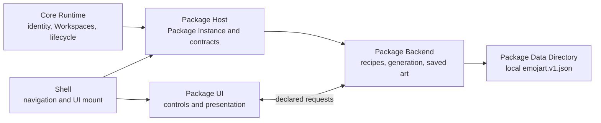
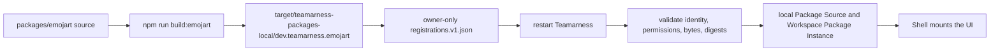

# Build your first Package with an agent

This guide builds Emojart, a small local art Package, from an empty `packages/emojart/` directory. It is for a developer who can review TypeScript and direct a coding agent, but does not need to write Rust or learn the Package Process Protocol frame format.

The agent writes the code. You set boundaries, review the changed files, run the commands, and inspect the desktop result. The finished Package has waves, ripples, and Sierpiński patterns; garden, ocean, space, and fruit palettes; a fresh result on every Generate press; and saved art that returns after an application restart.

## Before you start

Work in this repository on Apple silicon macOS. Install Rust 1.96 or newer and Node.js 24 or newer, then run `npm ci` and `cargo fetch --locked`. Emojart uses the repository-private `@teamarness/package-ui-sdk`, so this guide applies to a Package checked into this monorepo. It is not an external Package SDK recipe.

Start on a branch where `packages/emojart/` does not exist. The checked-in Emojart Package is the completed reference result. Read it after each agent step, not before. The normative Package documents are [the Package author guide](package-author-guide.md), [local registration guide](local-package-registration.md), and the schemas under [`contracts/packages/v1/`](../contracts/packages/v1/).

## Learn the ownership before asking for code

A Package is a vertical product module. The Core Runtime owns Installation identity, Workspaces, canonical membership, and Package lifecycle. The Shell owns Workspace controls, navigation, and Package UI mounting. The Package Host operates generic Package Instances and their contracts. Emojart owns its art rules, saved records, Backend, and UI.



A Package Source is the concrete Package Directory that an Installation discovers. A Package Identity stays stable across sources and versions. After admission, the host creates one Package Instance for each Workspace on that Installation. Each instance gets a separate Package Data Directory keyed by Installation, Workspace, and Package Identity. Emojart's saves are therefore Workspace-specific local data, not one global list for a profile.

Package trust is broad. The native Package Backend has the current user's filesystem, network, and process authority. It is not a sandbox. A same-webview Package UI can reach the Shell DOM and known Tauri commands. A Shadow Root separates styles, not authority. Review both parts before registering a Package.

## Step 1: declare the Package boundary

The first agent task creates the source tree and declares the contract before either side implements it. Keep the declarations small. Emojart needs requests only, no Semantic Capabilities, assets, subscriptions, networking, or synchronization.

### Agent brief 1

```text
Create the initial Emojart Package source under packages/emojart/ from an empty directory.

Authority:
- context/ontology.md defines Package, Package Source, Package Instance, and Package Data Directory.
- docs/package-author-guide.md and contracts/packages/v1/ define an admitted Package Directory.
- contracts/package-process/v1/ is normative protocol reference. Do not teach or hand-roll its frames.

Sources to inspect:
- packages/reference-package/ for repository shape only.
- crates/teamarness-package-sdk/README.md and packages/teamarness-package-ui-sdk/.
- root Cargo.toml and package.json for workspace conventions.

Constraints:
- Use Package Identity dev.teamarness.emojart.
- Add packages/emojart/teamarness.package.json and packages/emojart/ui-contract.json.
- Declare only emojart.read, emojart.generate, and emojart.save. Declare no subscriptions, capabilities, assets, network behavior, or synchronization.
- Do not add Emojart to packages/application-packages.v1.json or Tauri bundled resources.

Output:
- Rust Backend and TypeScript UI workspace directories wired into the root workspaces.
- A closed UI contract and manifest template with generated byte fields left for assembly.

Checks:
- Add contract and document tests at the existing Package seams.
- Run the narrow new tests, then cargo test -p teamarness-emojart-package --locked.
```

What changed: the manifest identifies the Package and its final files. The UI contract gives the UI and Backend a shared request vocabulary. It is not a runtime discovery mechanism.

### Human checkpoint 1

Review the contract without reading implementation details. Confirm it has `emojart.read`, `emojart.generate`, and `emojart.save`, an empty `subscriptions` object, and the identity `dev.teamarness.emojart`. Confirm the manifest has no capability declaration and no final byte values yet.

## Step 2: give the Backend the domain and local state

The Backend validates choices, creates a new unsigned 32-bit seed for each generation, renders the fixed 16 by 12 grid, and owns durable saves. The UI submits a recipe when saving. It never submits cells. The Backend regenerates and stores the cells, so it remains the source of truth.

### Agent brief 2

```text
Implement the Emojart Backend in packages/emojart/backend/.

Authority:
- crates/teamarness-package-sdk/README.md defines the supported Backend adapter and lifecycle boundary.
- packages/emojart/ui-contract.json is the complete request contract.
- context/.decisions/0003-core-runtime-vertical-packages.md assigns product records and UI to the Package.

Sources to inspect:
- packages/reference-package/backend/ for SDK lifecycle shape.
- packages/emojart/backend/tests/ for required public behavior examples.

Constraints:
- Support waves, ripples, and sierpinski; garden, ocean, space, and fruit; generatorVersion 1; and a 16 by 12 grid.
- Generate a fresh Backend-owned seed for every emojart.generate request. Equal recipes must render equal cells.
- Persist a closed schemaVersion 1 document named emojart.v1.json in the granted Package Data Directory. Use temporary-file replacement for saves.
- Keep lifecycle work bounded. Do not add capabilities, subscriptions, browser storage, network calls, or synchronization.

Output:
- Lifecycle-aware read, generate, and save behavior with stable artwork IDs.
- Real temporary-directory tests for save and reopen continuity.

Checks:
- Run cargo test -p teamarness-emojart-package --locked.
- Run cargo fmt --all --check and cargo clippy -p teamarness-emojart-package --all-targets --all-features --locked -- -D warnings.
```

What changed: the Package Backend owns formulas, validation, random seed creation, and the Package-owned JSON file. The Core Runtime assigns the directory but does not read, migrate, or synchronize that file.

### Human checkpoint 2

Ask the agent to show the tests that prove equal recipes reproduce a grid, selected unequal seeds differ, unknown choices fail, and a saved record reopens from a real temporary directory. Check that the state path is supplied by the host, not hard-coded or stored in browser storage.

## Step 3: add the UI without giving it host authority

The Package UI mounts into a Shell-provided Shadow Root with a mount-scoped client. It selects a pattern and palette, requests a draft, saves the visible recipe, and restores a selected saved piece. It does not call Tauri directly or own persistence.

### Agent brief 3

```text
Implement the Emojart UI in packages/emojart/ui/.

Authority:
- packages/teamarness-package-ui-sdk/src/index.ts defines the mount-scoped PackageClient.
- packages/emojart/ui-contract.json defines every allowed request and payload.
- docs/package-author-guide.md defines the ESM mount and idempotent-unmount requirements.

Sources to inspect:
- packages/reference-package/ui/src/index.ts for mount structure.
- packages/emojart/ui/src/index.test.ts for the fake client flow seam.

Constraints:
- Export mount(context) and return an idempotent unmount function.
- Use only context.client for emojart.read, emojart.generate, and emojart.save.
- Provide algorithm and palette selects, Generate, Save, a fixed CSS grid, saved-art selection, concise labels, and visible request errors.
- Generate must preserve selectors and ask the Backend for a new seed. Decorative cells stay out of the accessibility tree.
- Do not use direct Tauri commands, browser persistence, subscriptions, remote imports, or network calls.

Output:
- One ESM UI entrypoint and focused client-flow tests.

Checks:
- Run npm --workspace @teamarness/emojart-package-ui run build.
- Run npm --workspace @teamarness/emojart-package-ui run typecheck, lint, and test.
```

What changed: the UI presents state and sends declared requests. The Backend remains active with its Package Instance even when the UI is not visible.

### Human checkpoint 3

Read the UI test names and the rendered controls. Confirm the initial read causes a draft, Generate keeps the selected controls while requesting another draft, Save adds a saved-art control, and selecting saved art does not generate a replacement.

## Step 4: assemble final bytes, then admit them

Source files are not a Package Directory. Build output must contain the final executable, one ESM entrypoint, and the UI contract. Assembly copies those bytes, sets final permissions, and writes their final sizes and lowercase SHA-256 digests into the manifest.



### Agent brief 4

```text
Add the Emojart Package assembly command and its integration tests.

Authority:
- scripts/package-directory.mjs owns neutral final-byte staging.
- docs/package-author-guide.md defines final-byte admission requirements.
- docs/local-package-registration.md defines local source rules.

Sources to inspect:
- scripts/build-reference-package.mjs for existing reference-only behavior to avoid.
- scripts/build-emojart-package.test.mjs and scripts/package-directory.test.mjs for the integration seam.

Constraints:
- Add npm run build:emojart.
- Build the release Backend and ESM UI, then stage target/teamarness-packages-local/dev.teamarness.emojart/.
- Generate the manifest's final sizes and lowercase SHA-256 digests after copying final bytes.
- Do not change packages/application-packages.v1.json or apps/teamarness-desktop/src-tauri/tauri.conf.json.

Output:
- A valid installation-local Package Directory with Backend, UI entrypoint, UI contract, and manifest.

Checks:
- Run node --test scripts/package-directory.test.mjs scripts/build-emojart-package.test.mjs.
- Run npm run build:emojart and inspect the staged manifest.
```

### Human checkpoint 4

Run this command from the repository root:

```sh
npm run build:emojart
```

Check that `target/teamarness-packages-local/dev.teamarness.emojart/` has `teamarness.package.json`, the Backend executable, `ui/index.js`, and `ui/contract.json`. Check that the staged manifest has nonzero byte sizes and lowercase SHA-256 digests. The checked-in source manifest intentionally has placeholders.

## Step 5: register the local Package Source

Registration is an owner-only operator action. It does not bundle Emojart or enable it for a team. Start the named development profile once, quit Teamarness cleanly, then build and register the directory.

### Agent brief 5

```text
Review the proposed Emojart local-registration procedure without changing application code.

Authority:
- docs/local-package-registration.md is the registration and permission contract.
- packages/emojart/teamarness.package.json is the Package Identity authority.

Constraints:
- The source must be the assembled target/teamarness-packages-local/dev.teamarness.emojart directory.
- Use the named development profile emojart-tutorial.
- Keep expectedIdentity as dev.teamarness.emojart and use the complete trusted_native_code_v1 acknowledgement.
- Do not add Emojart to application metadata, bundled resources, Workspace enablement, or synchronization.

Output:
- Report the exact registration path, required owner-only modes, and restart requirement.

Checks:
- Compare the proposed JSON against contracts/packages/v1/schemas/registrations.schema.json.
- Confirm the application metadata and Tauri resources still omit Emojart.
```

### Human checkpoint 5

First create the profile, then quit the application:

```sh
npm run dev -- emojart-tutorial
```

Build the Package if you have not already, then write the registration. Run this from the repository root so `pwd -P` gives the canonical absolute repository path:

```sh
npm run build:emojart
repository="$(pwd -P)"
profile="$repository/.teamarness-dev/emojart-tutorial"
package_directory="$repository/target/teamarness-packages-local/dev.teamarness.emojart"
mkdir -p "$profile/packages"
chmod 700 "$profile" "$profile/packages"
cat > "$profile/packages/registrations.v1.json" <<EOF
{
  "schemaVersion": 1,
  "registrations": [
    {
      "directory": "$package_directory",
      "expectedIdentity": "dev.teamarness.emojart",
      "trust": {
        "kind": "trusted_native_code_v1",
        "acceptedRisks": ["filesystem", "network", "process"]
      }
    }
  ]
}
EOF
chmod 600 "$profile/packages/registrations.v1.json"
```

The registration path is `.teamarness-dev/emojart-tutorial/packages/registrations.v1.json` under this clone. Do not add `overrideApplication`: Emojart has no bundled Package with the same identity. Do not paste invitations, keys, or database contents into this file.

Restart the profile after creating, changing, or removing the registration:

```sh
npm run dev -- emojart-tutorial
```

Confirm the Shell reports source `local`, trust `trusted_native_code_v1`, an active lifecycle, and the Emojart UI. If it does not, stop and fix the registration before testing art behavior.

## Verify the result and the restart loop

Use the same named profile and Workspace. Try all three patterns with more than one palette. Press Generate several times without changing either select and confirm a visibly different grid. Save at least two pieces, stop Teamarness cleanly, restart the same profile, and confirm both pieces return unchanged.

Then create or select a second Workspace. It should start with an empty saved-art list. That difference is expected. The installation-local Package Source is admitted once for the Installation, while each Workspace has its own Package Instance and Package Data Directory.

When source changes, rebuild first and restart second:

```sh
npm run build:emojart
npm run dev -- emojart-tutorial
```

There is no hot reload for admitted Backend bytes. Teamarness reads registration and admits bytes at startup. If a Backend file changes while Teamarness is running, the host can reject a spawn with `artifact_changed`. A restart admits the deliberate rebuild. Rebuilding does not erase saves because the data directory follows Installation, Workspace, and Package Identity rather than the source path or Package version.

## Troubleshooting

- **Registration permissions:** Make the profile and `packages` directory owner-only with mode `700`, and `registrations.v1.json` owner-only with mode `600`. The file must be regular and not a symlink.
- **Identity mismatch:** Keep `expectedIdentity` equal to `dev.teamarness.emojart`. Do not change it to hide a manifest error.
- **Missing artifacts:** Run `npm run build:emojart`, then inspect the staged directory rather than registering `packages/emojart/` source files.
- **Digest mismatch:** Rebuild and register the newly staged directory. Do not edit files inside the admitted directory after assembly.
- **Unsupported target:** This tutorial builds the `aarch64-apple-darwin` Backend. Another target needs a declared, self-contained executable and its own support work.
- **Invalid UI contract:** Keep request names and payloads aligned with `packages/emojart/ui-contract.json`. The host rejects undeclared operations, invalid schemas, and changed contract bytes.
- **Stale bytes:** Stop Teamarness, rebuild, and start the named profile again. A running process does not discover changed Backend bytes.

## Keep the boundary honest

Emojart is local-only. It has an installation-local Package Source and Workspace-specific local state. It does not add bundling, Workspace registration or enablement, networking, peer-to-peer replication, synchronization, or team collaboration.

A future tutorial will cover promotion to application distribution, Workspace enablement, and synchronized team behavior through a Synchronization Capability. Those need separate trust and product decisions. A local registration file does not stand in for any of them.

The architecture recap is short: the Core Runtime owns shared application authority, the Shell owns mounting, the Package Host owns generic admission and routing, and Emojart owns art behavior and local records. That split lets you direct an agent with clear authority while keeping the Package small enough to inspect.
